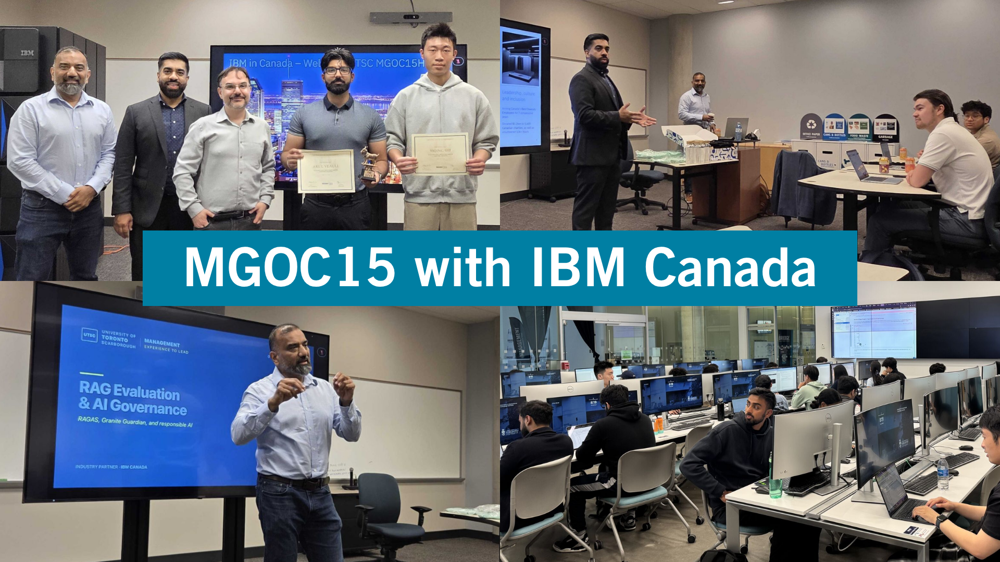

---
format:
  revealjs:
    theme: [simple, styles/mab.scss]
    css: styles/shared.css
    title-slide: false
    width: 1280
    height: 720
    margin: 0
    center: false
    transition: none
    slide-number: c/t
    controls: true
    controls-layout: edges
    progress: false
    hash: true
    history: true
    touch: true
    navigation-mode: linear
    overview: true
    auto-stretch: false
    pdf-separate-fragments: false
    pdf-max-pages-per-slide: 1
    preview-links: false
---

## We need your help {#introduction}

Management Advisory Board · October 2026

AI specialists &amp; future program development

Help us shape how Management students learn, apply AI and connect with employers.

<h3>What employers need</h3>
What capabilities should our graduates bring?

<h3>What we should build next</h3>
Where can we offer something distinctive?



::: {.notes}

30 seconds. We need your help on AI specialists and future program development. We will look briefly at the existing AI education landscape, show how we can build on our industry connections, and walk through a proposed student journey. We would value your advice on the capabilities employers need and where UTSC Management can offer something distinctive. This opening is included within the ten-minute total; keep the student journey to 2 minutes 30 seconds and retain 2 minutes 30 seconds for board feedback.

:::

## AI programs in Toronto and Ontario {#programs}





::: {.notes}

1 minute. Ontario already offers undergraduate streams, master's degrees and certificates. These serve different learners, and several include industry experience. Our question is how to build an AI pathway for current and prospective UTSC Management students. Optionally select Schulich for up to 20 seconds. All twelve programs are accessible through the selector on this slide. The right-hand panel holds the supporting details and sources.

:::

## Our industry connections {#industry}

::: {.industry-layout}

::: {.industry-photo}

<button class="photo-button" data-photo="ibm" aria-label="Enlarge photographs of MGOC15 with IBM Canada" aria-haspopup="dialog"></button>

MGOC15 · Business Data Analytics

:::

::: {.industry-copy}

12months

of paid work experience in Management co-op

<strong>Industry in the classroom</strong> MGOC15 was co-developed and co-taught with IBM practitioners, on campus and at IBM Canada.

<a href="https://utsc.utoronto.ca/mgmt/why-co-op" target="_blank" rel="noopener noreferrer">Management co-op overview</a> Course example: October 2026 MAB materials

:::

:::



::: {.notes}

1 minute 30 seconds. Our co-op relationships are a foundation for bringing industry further into students' learning. The existing MGOC15 course was co-developed and co-taught with IBM practitioners and included learning on campus and at IBM Canada. The photographs show a concrete example. What would it look like if this kind of engagement extended across several courses? No additional click is needed.

:::

## The next step in business education {#recruitment}





::: {.notes}

1 minute, including one optional click. Our Management expertise, work-integrated learning and industry relationships can support a distinctive next step in business education. The proposed AI certificate is one starting point, developed alongside Computer Science. Follow the connections: business questions and technical foundations meet practitioner involvement and applied experience. Recruitment makes students’ skills and learning experiences visible to hiring organizations. Click either Partners or Reimagine recruitment for a brief explanation; all elements remain available for later exploration. Partners could include Computer Science and other departments, providing foundations in software and hardware. Industry collaboration includes co-developed courses and activities across all courses. Recruitment invites hiring organizations into courses, hackathons and events. Curriculum design with these partners is presented as a proposal. Transition to the student journey to show what the certificate journey could look like. Keep the overall presentation and discussion within ten minutes.

:::

## AI certificate: a student journey {#certificate}





::: {.notes}

2 minutes 30 seconds. Follow one Management student from left to right. The animation runs once on entry; pause it to discuss a stage, select a stage directly, or replay. Spend 30 seconds on foundational courses in business problems, data literacy and responsible AI. Spend 60 seconds on the three illustrative industry course experiences: Google Gemini for Agentic AI; Microsoft Copilot Studio and Power Automate for agents and automation; SAS Viya for analytics and decisions. An optional course click shows an assignment and links to the official tool pages. Spend 30 seconds on Apply & test: students demonstrate work at hackathons and showcases, receive feedback and interact with potential recruiters. Finish with 30 seconds on the intended outcome: moving directly into a company and applying these skills in a team. This is a proposed pathway, with partner participation, academic requirements and employment outcomes to be developed. The recruiter-event image is AI-generated and depicts fictional people. Reach the board question by elapsed minute 7.

:::

## Advice from the board {#discussion}

::: {.discussion-layout}

::: {.discussion-question}

<ol class="board-questions">
<li>Would this pathway help attract Management students and prepare graduates you would want to hire?</li>
<li>What capability would you most want students to demonstrate?</li>
<li>Do you see value in this concept from a hiring/recruitment perspective?</li>
<li>What else could we consider to make the graduates more future ready?</li>
</ol>

:::

::: {.explore-invitation}

<a href="index.html">Open these slides</a>

andrecire.github.io/ mab-ai-2026

:::

:::



::: {.notes}

2 minutes 30 seconds for feedback, followed by a short closing sentence within the overall ten-minute limit. Show the four numbered questions and invite two brief responses to whichever questions resonate most. Use the prompts to focus discussion rather than asking for a separate round of answers to every question. Close: Your feedback will help us choose the capabilities and partner involvement to test in a pilot. The program directory and course details remain available at the link. There is no shared poll or response collection.

:::

